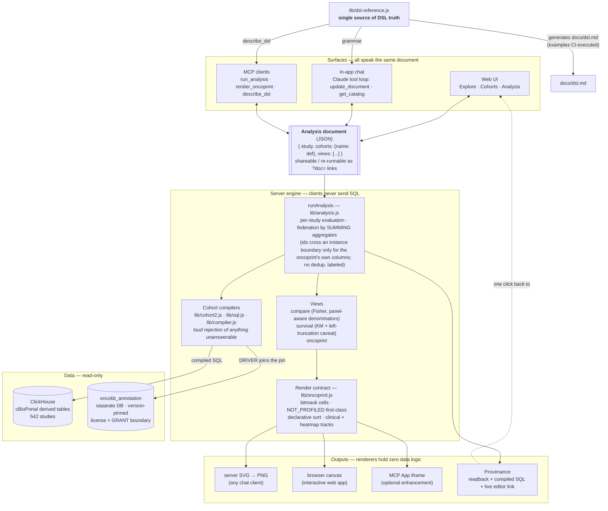

# Cohort Lab — what it is and why it's built this way

## In one sentence

Cohort Lab is a demonstration that a cBioPortal-class tool can be rebuilt around **one
declarative object** — the Analysis document (cohorts defined by OQL / clinical / timeline
clauses, plus views) — that a human, a chatbot, and an MCP client all read and write, with the
server compiling it to ClickHouse SQL and every result carrying its own provenance.

That one object also carries the project's future: **saved**, it generalizes the portal's user
state — virtual studies, groups, sessions — from frozen ID lists into living, diffable
definitions with dynamic membership and versioned annotation (roadmap, below); and being a
**portable representation of the question** rather than of any backend, it already extends
across portal instances — **cross-instance federation is built**, in both a data-level and a
document-level mode, verified to agree to the last digit against a real second ClickHouse
instance reached both directly and as an MCP peer.

**Key advantages at a glance:**

- **Reproducible, shareable analyses** — the artifact is a re-runnable document with pinned
  annotation, not a screenshot
- **LLM-safe by construction** — models write the DSL, never SQL; the unanswerable is rejected
  loudly instead of approximated
- **Full provenance** — every result links to its definition, its compiled SQL, and a live
  re-runnable view; federated results carry the *same* provenance across the instance boundary
  (a peer discloses the SQL it ran and what it cost)
- **Methodological honesty enforced by the engine** — panel-aware denominators, left-truncation
  and prior-treatment caveats, labeled non-deduplication
- **One semantics owner, many cheap surfaces** — web UI, chat, and MCP all speak the same
  document; docs and grammars are generated from one source
- **Cross-instance federation, built and verified** — one document fulfilled across ClickHouse
  instances or over MCP to a peer, with every visualization stating which participants answered
  and how (built-in, not roadmap)
- **Living user state** *(roadmap)* — dynamic groups, versioned annotation, and membership
  diffs subsume virtual studies / groups / sessions
- **An honest oracle for AI hypothesis generation** *(roadmap)* — a hypothesis written as a
  document is pre-registered, testable, multiplicity-counted, and replicable across sites by
  construction; the generator stays creative because the tester cannot be

## The advantages of the approach

**1. The document is the deliverable, not the picture.** A chat conversation doesn't end in a
screenshot; it ends in a small JSON object that *is* the analysis. That object re-runs
identically later (OncoKB annotations are version-pinned), can be handed to a colleague as a
URL, edited in the UI, or refined in another conversation. This is the single biggest advantage
over "chatbot draws a chart": the artifact survives the conversation. It is also the seed of a
better persistence model than the portal's — a saved definition subsumes virtual studies,
groups, and sessions, and makes dynamic groups and annotation-version diffs corollaries rather
than projects (see *User state*, below).

**2. Trust boundaries that make an LLM safe to put in front of real data.** The model never
writes SQL — it writes the DSL, the server compiles it. Anything the data can't honestly answer
is rejected loudly (`GAIN` unsupported, unknown attribute, profile doesn't exist in this study)
instead of silently approximated, so hallucination turns into a visible error the model
corrects — not a plausible wrong number. Methodology caveats are attached to results *by the
engine*, not left to the model's goodwill (concrete examples below).

**3. Provenance as the answer to "why should I believe this?"** Every result links to a page
showing the definition, the exact SQL each cohort compiled to, and the live re-runnable
analysis. For a scientific audience this is the feature: a skeptical reviewer can audit the
whole chain without trusting either the chatbot or us.

**4. One interface, many cheap surfaces — and many cheap backends.** Because everything speaks
the document, each new surface has been thin: the in-app chat is a small loop around the same
`runAnalysis`, the MCP tools are wrappers over the same engine, and the DSL documentation is
*generated from* the same source module the chat prompt uses — so nothing can drift, because
there is one semantics owner. The same property cuts the other way: since no SQL ever crosses a
study boundary, the backends can multiply as cheaply as the surfaces did — cross-instance
federation is a routing change, not a redesign (see *Cross-instance federation*, below).

**Visualization is layered accordingly**: server-rendered PNGs for any chat client
(works everywhere, today), and a provenance/editor link that opens the fully interactive
version in the web app one click away. Fancier in-chat rendering (MCP Apps) exists as an
optional, additive experiment on top — the load-bearing path never depends on it.

## The shape of the system

Every surface reads and writes the same document; the engine owns all semantics; data access is
read-only with the licensed annotation store isolated behind its own database grant; and the
DSL's documentation, chat grammar, and MCP self-description all render from one source module.

## Methodological honesty, with concrete examples

These four caveats are not fine print — each one changes real numbers materially, which is why
the engine computes and attaches them rather than leaving them to prose. All figures below are
reproducible against the live app (msk_chord_2024, 24,950 patients, OncoKB v7.4 pinned).

### Panel-aware denominators

Not every patient was sequenced for every gene. **MSH3** sits only on the newer MSK-IMPACT
panels: in MSK-CHORD, 19,979 of 24,950 patients were profiled for it. 510 patients carry an
MSH3 alteration — that's **2.6%** of the profiled, but only **2.0%** if you naively divide by
the whole study. The naive figure understates the frequency by a quarter, and the error is
invisible for genes on every panel (TP53: 53.5% either way), which is exactly what makes it
treacherous. Cohort Lab therefore renders "not profiled" as a first-class oncoprint cell state
(striped — a different statement than "no alteration") and computes every frequency and every
Fisher test over profiled patients only.

### Left truncation

Survival in MSK-CHORD is measured from each study's own baseline — effectively the MSK
sequencing date, not diagnosis. A patient must have survived long enough to be sequenced at MSK
to enter the cohort at all, so naive Kaplan–Meier curves carry immortal-time bias. When Cohort
Lab reports, say, median OS of **20.2 months for STK11-driver patients**, the attached caveat
says exactly what that number is: months from *this study's baseline*, not from diagnosis —
which means it cannot be compared against literature medians measured from diagnosis, and
cross-study survival comparisons additionally note that the two studies' baselines are not
harmonized with each other.

### Prior-treatment guard

"First-line immunotherapy" is a temporal claim the data only partially supports: roughly 20% of
MSK-CHORD's treated patients carry an NLP-derived "prior medications to MSK" flag, and another
~20% are undetermined. The difference is not marginal: **3,341** patients have a "first"
immunotherapy event on their MSK timeline, but only **2,392** remain after the prior-treatment
guard (`priorGuard: true`) — meaning **28% of the unguarded cohort** received their *observed*
first immunotherapy, not necessarily their *actual* first. Cohort Lab makes the guard an
explicit DSL flag and warns whenever a query leans on "first" without it. (The same honesty
applies to absence queries: `NOT_FOLLOWED_BY` supports an observability guard so "no
progression recorded" is not conflated with "lost to follow-up".)

### No cross-study deduplication

A cohort spanning **msk_chord_2024 + msk_met_2021** with `TP53: MUT` contains **25,555
members: 13,105 from CHORD plus 12,450 from MET**. These are two MSK studies with overlapping
enrollment windows — some of those are the same human being counted twice, and the data
provides no reliable way to link them. Rather than pretend otherwise, Cohort Lab keys every
cross-study member by `study + patient id`, never deduplicates, and says so in every federated
view: comparisons caption it, oncoprints add a Study track showing each column's origin and note
that duplicates appear as separate columns, and the Explore header reads "(overlap not
deduplicated)". The deliberate design position: an honest count with a stated limitation beats
a "corrected" count resting on a linkage the data can't support.

---

*The common thread: every one of these is enforced in the engine (`lib/analysis.js`,
`lib/oncoprint.js`, `lib/compiler.js`), surfaces in results as machine-attached captions, and
is documented in the generated DSL reference (`docs/dsl.md`) whose examples are executed
against the live compiler on every test run.*

## User state: from frozen ID lists to living definitions

*(Proposed direction — not yet built. This may be the strongest justification of all.)*

The portal's persistence artifacts — **virtual studies, groups, sessions** — are what make
analysis reproducible, continuable, and shareable across time. Underneath, they are all the
same thing: **frozen ID lists** in the session service. That representation was never a design
choice; it was forced. The portal has no language for *why* a sample belongs to a group, so
the only thing it can save is the enumeration. Every known weakness of these artifacts follows:
virtual studies go stale as studies grow, groups can't explain themselves, a session can be
reloaded but not meaningfully edited.

A DSL cohort is the **intensional** counterpart — it saves the *rule*, not the roster. Once
the saved artifact is a rule, two long-wished-for features stop being projects and become
corollaries:

- **Dynamic groups** are just *evaluation time*: "STK11-driver never-smokers" re-run today
  includes the patients loaded since the cohort was saved. The portal could never build this
  without first building a membership language — the language was the hard part, and it exists.
- **Versioned annotation** is already half-built here: a saved definition plus the OncoKB pin
  is a reproducible driver-dependent cohort — structurally impossible in the portal, where
  annotation is baked into the database at load time.

### The artifact model: definition + frozen evaluation + diff

Extensional artifacts aren't wrong — a published paper's cohort *should* be frozen. The saved
artifact should therefore be a trio: **(1)** the definition (small JSON — the rule), **(2)** a
frozen evaluation (member ids, counts, annotation pin, data timestamp at save time), and
**(3)** the diff between them, computed on demand. That covers all three portal verbs and adds
a fourth the portal has never had:

| verb | mechanism |
|---|---|
| **Reproduce** | the frozen evaluation — exact members, exact pin |
| **Continue** | re-evaluate the definition against today's data |
| **Share** | the definition is self-describing (readback, pills, compiled SQL — provenance already built) |
| **Understand change** | the diff: *"since you saved this: +214 patients entered, 3 left; 12 membership changes came from OncoKB v7.4→v7.5 reclassifying STK11 variants"* |

Drift stops being a silent bug (the stale virtual study) and becomes a first-class, explained
result. A dynamic group with drift notifications is effectively a continuously running
screening rule — for use cases like trial matching, genuinely new capability.

### Why this completes the chat-first argument

A chat transcript is not a scientific artifact — it can't be re-run, diffed, or cited. The DSL
is the **persistable residue of a conversation**: chat needs the language to be *safe*
(trust boundaries, above), and it needs the language to have *memory*. A user-aware MCP server
is the natural custodian, because one artifact store then serves every surface — "compare my
STK11 cohort against never-smokers" in chat, a "My cohorts" list in the web UI, `$ref`-style
cohort references inside analysis documents over MCP.

Architecturally this is an evolution, not an invasion: cBioPortal already keeps user state
outside the portal database (the session service). This keeps that separation — a small
writable artifact store, never the read-only analytics database — but upgrades what is stored
from ID lists to definitions. Virtual studies are subsumed rather than replaced: DSL cohorts
are already cross-study, which is the main thing virtual studies exist to do.

### Honest caveats

Full reproducibility needs **data versioning** too — a definition re-evaluated after a study
re-import changes with no pin to blame. The frozen evaluation is the pragmatic fallback (the
exact saved members are always retained), but a real deployment would stamp import
timestamps/release tags into evaluations so the diff can attribute change: *data changed* vs
*annotation changed* vs *the rule matched differently*. And **identity is real work** (OAuth on
the MCP server, auth on the web app) — unglamorous but well-trodden.

A minimal demonstrator: a tiny writable store; `save_cohort` / `list_cohorts` / `diff_cohort`
as MCP tools and UI; `$ref` resolution in documents; and one staged demo — save a cohort, bump
the OncoKB pin, show the diff explaining exactly which patients moved and why. That last
screenshot is the whole pitch in one image.

## Cross-instance federation — built, and verified against a real second instance

*(This was the roadmap section. It is no longer proposed: both modes below are implemented,
exercised against a genuinely separate ClickHouse database, and cross-checked against each
other to the last digit — the strongest stress-test the project's central claim has had.)*

The critical enabling fact, unchanged from the original proposal and now proven in practice:
**no SQL in this engine ever crosses a study boundary.** The compilers are single-study by
design, and federation — cross-study cohorts, compare, survival, cooccurrence, coexpression,
clinical, hotspots, oncoprint — happens in the application layer, by summing per-instance
*aggregates*, never by merging patient-level rows in JS. (An earlier version of this document
described member ids being merged; that path was removed — see *Aggregation, not id-merging*,
below.) Every SQL statement the engine emits is executable against *whichever database holds
that study*, which is why extending from one connection to several was a routing change, not a
redesign.

### Two federation modes, both implemented

| mode | instance is reached as | what crosses the wire | fits |
|---|---|---|---|
| **Data-level** | a second ClickHouse connection (`CLICKHOUSE2_*`) | aggregates, computed per-instance and summed by the one engine | instances under one trust umbrella |
| **Document-level** | another Cohort Lab, over MCP (`PEER_MCP`) | a cohort definition out; *counts* back, never rows | institutions that cannot share patient-level data |

Both were run against the same real second database (a separate ClickHouse instance holding a
GENIE-derived study, `cbioportal_genie_green`) — once as a direct data-level connection, once
fronted by a second Cohort Lab process reached purely over MCP — and the two were compared:

- cohort sizes: **25,555 / 24,627** patients, identical on both paths
- per-gene compare counts, identical
- **stratified log-rank χ² = 1594.0863 over 2 strata**, identical
- KM medians **30.641 / 68.449 months**, identical
- co-occurrence 2×2 tables, identical

That is not a claim the architecture *should* make aggregation exact — it is the result of
actually running the same document two structurally different ways and diffing the output.

### Aggregation, not id-merging — why the earlier plan was wrong

The original version of this section proposed federating by having the engine fetch member ids
from every instance and merge them. That was implemented, then found to be both **unnecessary**
and **wasteful**: `runAnalysis` was calling every patient-level instance for its full id list
purely so `list.length` could serve as a count — for a two-study TP53 cohort that is 25,555
identifiers pulled across the wire and discarded; at the 32-study PanCan benchmark scale it was
267,816. Cohort evaluation now asks every instance for a **count**, patient-level included; the
one view whose output *is* patients (oncoprint) carries the compiled cohort SQL and re-derives
its own columns inside the owning database. The consequence: for any document with no oncoprint
view, **no patient identifier crosses an instance boundary at all** — not because the deployment
restricts it, but because nothing in the computation needs one.

### What actually federates, and why each one is a sufficient statistic

Six views were built on top of this, and each is federatable for the same underlying reason:
the statistic each computes decomposes into per-site sums that never need an individual's
identity — the same argument the original proposal made in the abstract, now built out
concretely for six different statistics:

- **Survival — study-stratified log-rank.** The log-rank statistic is a sum over event times of
  quantities built from at-risk and event counts, so each *site* can be its own stratum. That is
  not merely more private than pooling — it is more correct: pooling risk sets across sites
  assumes a common baseline hazard, and when case mix differs the pooled statistic can point the
  wrong way (Simpson's paradox). Verified against the published Freireich 6-MP trial (χ²=16.79)
  before ever touching federated data.
- **Co-occurrence.** Four counts per gene pair per site — both altered, one, the other,
  neither — nothing else. "Profiled for both" is computed *at* each site against its own gene
  panels, which pooled exports cannot get right. Across sites the test is
  Cochran–Mantel–Haenszel, the pairwise analogue of stratified log-rank.
- **Clinical comparison.** A numeric attribute reports only `(n, Σx, Σx²)` per site — three
  numbers — from which the pooled mean and variance are *exact*, not approximated, and no
  individual value is ever transmitted.
- **Co-expression.** Six sums per gene pair per site (`n, Σx, Σy, Σxy, Σx², Σy²`) are sufficient
  for Pearson's r; the federated correlation is proven exact by construction, not estimated.
  Where sites disagree, a Fisher-z meta-analysis of per-site correlations is reported alongside
  the pooled figure, because pooling silently assumes the sites are exchangeable.
- **Hotspots.** The one case where the aggregate itself is disclosive — a variant carried by one
  patient is close to an identifier — so a `minCount` suppression floor is applied **by each
  site, inside its own SQL, before anything is returned**. The coordinator never sees, and so
  cannot leak, a value the site withheld.
- **Oncoprint z-score reference.** The sharpest demonstration of the whole argument: a site that
  discloses no patients contributes no columns, by the same rule that has always governed the
  oncoprint — but it can still supply three totals per gene (`n, Σx, Σx²`) that widen the
  reference distribution the *drawn* columns are scored against. A site can shape what a chart
  means without appearing in it.

### Provenance survives the boundary

The provenance guarantee from the top of this document — every result links to its definition,
its compiled SQL, a live re-runnable view — does not stop at an instance boundary. A remote peer
now discloses the SQL it actually compiled and ran (`carriesPatientIds()` is checked before any
request leaves, so there is nothing unsafe about disclosing the query itself; a deployment that
treats its schema as sensitive can opt out). Query-level timing crosses too: a federated view's
"how these numbers were computed" panel shows the peer's real query, marked as having executed
*there*, with the latency it actually cost — the number that matters when deciding whether a
remote participant belongs in an analysis at all.

Every visualization also carries an explicit participation marker, deliberately split into two
facts rather than one word: **method** (`aggregate-only` for every view but the oncoprint,
*regardless of deployment* — the arithmetic never changes) and **sources** (how many
participants were aggregate-only, or reached via an MCP peer). They are kept apart because a
single label like "mixed" would wrongly suggest the *feature* varies by who answers, which is
exactly what this architecture is built to prevent.

### A bug this actually caught

Running both modes side by side against the same data is not merely a demonstration — it is a
working oracle, and it found a real defect. A `not` clause was compiling against the primary
database regardless of which instance actually owned the study, so a GENIE wild-type cohort
computed as 0 patients instead of 202,750. It surfaced because the data-level and document-level
answers *disagreed with each other*; neither number alone would have looked wrong. That is the
practical argument for building two federation modes rather than trusting one: they cross-check.

### What is still open

The honest remainder, unchanged in kind from the original plan:

1. **OncoKB store replication.** `DRIVER` still joins `oncokb_annotation` on the primary
   connection only; a genuinely multi-instance deployment needs the (small, ≈135k-variant,
   already-idempotent) sync pipeline replicated per instance, with a loud label when pins
   diverge across the federation rather than one assumed pin.
2. **N-way instance registry.** The connection layer today is `PRIMARY` plus one optional
   `secondary()` (`CLICKHOUSE2_*`) for data-level, and one `PEER_MCP` mapping per study for
   document-level — proven correct at that scale, not yet generalized to an arbitrary list of
   instances.
3. **Partial availability inside a running analysis.** The study *catalog* already isolates a
   failing instance (`studiesFor(c).catch(() => [])` — one unreachable peer cannot empty the
   list), but a timeout mid-survival-view does not yet degrade to a labeled partial result the
   way the catalog does.
4. **Schema drift and per-instance authorization** remain exactly as scoped originally: a
   version handshake with loud rejection below the floor, and an identity layer that composes
   with the user-state proposal below rather than adding a second system.

None of these change the shape of the answer above — they are hardening a mechanism already
proven correct, not open design questions.

## An honest oracle for AI hypothesis generation

*(Proposed direction — not yet built. It composes the pieces above rather than adding a new
mechanism.)*

AI hypothesis-generation systems — Google's Co-Scientist, FutureHouse's Robin and their
successors — generate, critique and tournament-rank hypotheses, mostly from literature. The
scarce resource has flipped: proposing a thousand plausible hypotheses is cheap; **testing them
honestly is not.** Where these systems test against data at all, an agent writes pandas or R
against an export, and the 2026 "agentic garden of forking paths" results show what that costs:
agents reproduce most of the analytical divergence of human teams, bend toward whatever they
already believed, and their reports pass methodological review anyway. The test step is the
weak link, and it is opaque.

Cohort Lab's natural role is not the generator. It is the **executable hypothesis language and
the falsification oracle** that generators lack.

### The hypothesis is the document

"STK11-driver with KEAP1 co-mutation predicts worse overall survival in lung adenocarcinoma" is
already a two-cohort, two-view Analysis document. A generator that emits documents rather than
paragraphs has formalized its hypothesis into something machine-checkable, hashable and
re-runnable *before any result exists*. That is pre-registration as a side effect of the file
format: the definition is written, timestamped and committed to, and only then evaluated. No
co-scientist system has a hypothesis language; they have prose.

### The oracle, not the generator

The engine answers in seconds with panel-aware denominators, the left-truncation caveat, the
prior-treatment guard and the compiled SQL — the same result, whichever agent asked. The
analytical choices that fork are made once, in the engine, and disclosed in the result. This is
the right separation of concerns: creativity and honesty want to live in different components
with a narrow interface between them, and the document *is* that interface. The generator can be
as inventive as it likes because the tester cannot be persuaded. The tool should stay on its
side of that line: it evaluates hypotheses, it does not propose them, and everything it returns
is labeled as an association in a retrospective cohort — by the readback, not by the model's
goodwill.

### Testability triage

Loud rejection sorts a proposed hypothesis into three bins: answerable in this study;
answerable in another study (a catalog search over the 542 studies — "which have treatment
timeline events and a PFS endpoint?" — is an agent's question, not a facet's); or unanswerable
with any of this data. Co-scientist systems rank by plausibility and novelty and have no idea
what data exists. Telling a generator *what can be tested* is a cheap and large contribution.

### Multiplicity as a ledger

This is the role to push hardest. An agent that runs five hundred documents and reports the
twelve with p < 0.05 is p-hacking at machine speed, and it will happen. Because documents are
canonical JSON, the tool can keep a **campaign ledger**: every document registered under a
question, with its hash, timestamp and result — nulls included. A reported finding then carries
"1 of 512 tested, q = 0.31" whether the agent wants it to or not. The forking-paths literature
proposes an *m-value* — the probability that a plausible analysis path yields a claim at least
as extreme as the one reported — estimated by having agents sample paths. Here the space of
paths is a grammar, so it is enumerable rather than sampled, and the estimate becomes a count.

The same ledger is a **negative-result memory** — the result cache keyed by document hash,
exposed as "has this been asked before, and what happened?" An institution that kept that record
would hold something no co-scientist vendor can offer: an audit trail of every hypothesis its
agents tested, including the ones that failed.

### Replication is a routing change

The same document runs on the discovery study and on a peer instance without a row moving. A
campaign becomes: discover on msk_chord_2024, replicate on GENIE over MCP, keep only what
survives — with every figure's participation marker stating which site answered. Replication is
the step AI hypothesis pipelines skip because it needs a second dataset they cannot reach.
Cross-instance federation, already built, makes it a parameter.

### The temporal niche

Nearly all AI hypothesis generation in cancer genomics is static — gene with gene, gene with
outcome. Clinical hypotheses are about *course*: who progresses within six months of first
immunotherapy, what follows what, who reaches a third line. The timeline sub-DSL is an
executable language for exactly that class, and it is where an agent can propose hypotheses a
human would not have enumerated. It is also where an honest oracle matters most, because
immortal time and observability bias are precisely the traps a code-writing agent walks into.

### What it would take

Three tools on top of the saved-definition and federation work already described:

| tool | does |
|---|---|
| `register_hypotheses(documents[])` | hashes and timestamps a batch under a named question — the pre-registration |
| `run_campaign(question)` | evaluates the batch with a shared multiplicity adjustment and records every result, null or not |
| `replicate(document, study)` | re-runs one document against a named study or federated peer |

plus the negative-result memory, which is the result cache with a query interface. None of it
changes the engine; all of it depends on the engine being the one place where the analytical
choices are made.

