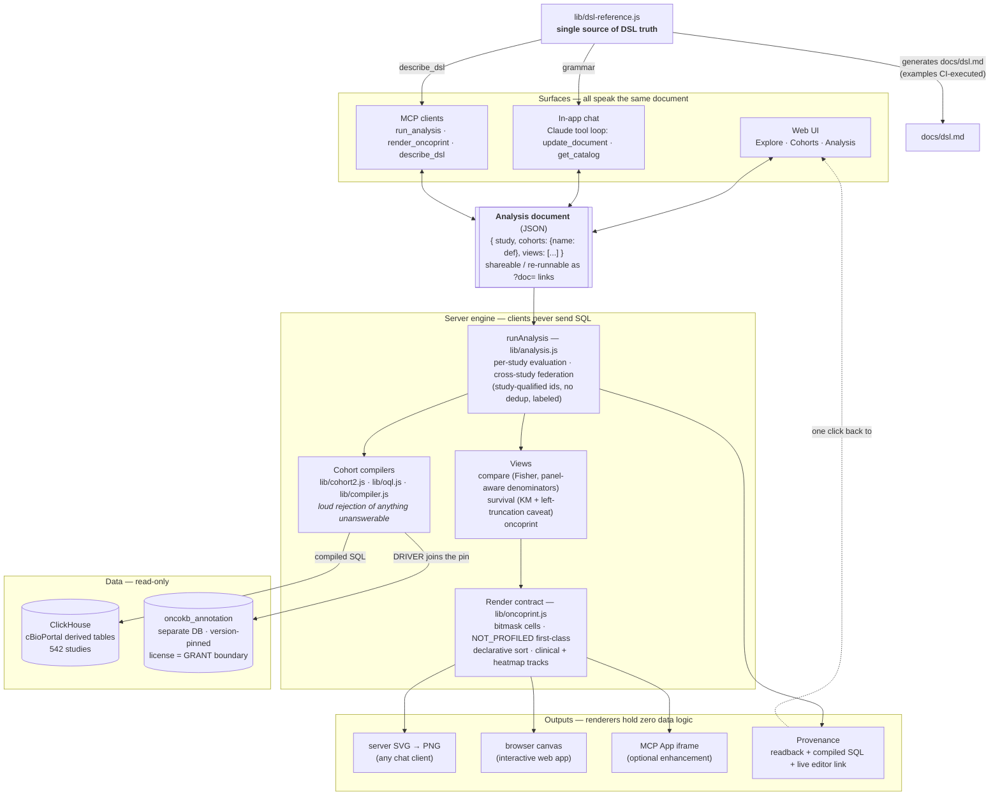

# Cohort Lab — what it is and why it's built this way

## In one sentence

Cohort Lab is a demonstration that a cBioPortal-class tool can be rebuilt around **one
declarative object** — the Analysis document (cohorts defined by OQL / clinical / timeline
clauses, plus views) — that a human, a chatbot, and an MCP client all read and write, with the
server compiling it to ClickHouse SQL and every result carrying its own provenance.

## The advantages of the approach

**1. The document is the deliverable, not the picture.** A chat conversation doesn't end in a
screenshot; it ends in a small JSON object that *is* the analysis. That object re-runs
identically later (OncoKB annotations are version-pinned), can be handed to a colleague as a
URL, edited in the UI, or refined in another conversation. This is the single biggest advantage
over "chatbot draws a chart": the artifact survives the conversation.

**2. Trust boundaries that make an LLM safe to put in front of real data.** The model never
writes SQL — it writes the DSL, the server compiles it. Anything the data can't honestly answer
is rejected loudly (`GAIN` unsupported, unknown attribute, profile doesn't exist in this study)
instead of silently approximated, so hallucination turns into a visible error the model
corrects — not a plausible wrong number. Methodology caveats are attached to results *by the
engine*, not left to the model's goodwill (concrete examples below).

**3. Provenance as the answer to "why should I believe this?"** Every result links to a page
showing the definition, the exact SQL each cohort compiled to, and the live re-runnable
analysis. For a scientific audience this is the feature: a skeptical reviewer can audit the
whole chain without trusting either the chatbot or us.

**4. One interface, many cheap surfaces.** Because everything speaks the document, each new
surface has been thin: the in-app chat is a small loop around the same `runAnalysis`, the MCP
tools are wrappers over the same engine, and the DSL documentation is *generated from* the same
source module the chat prompt uses — so nothing can drift, because there is one semantics owner.

**Visualization is layered accordingly**: server-rendered PNGs for any chat client
(works everywhere, today), and a provenance/editor link that opens the fully interactive
version in the web app one click away. Fancier in-chat rendering (MCP Apps) exists as an
optional, additive experiment on top — the load-bearing path never depends on it.

## The shape of the system

Every surface reads and writes the same document; the engine owns all semantics; data access is
read-only with the licensed annotation store isolated behind its own database grant; and the
DSL's documentation, chat grammar, and MCP self-description all render from one source module.

## Methodological honesty, with concrete examples

These four caveats are not fine print — each one changes real numbers materially, which is why
the engine computes and attaches them rather than leaving them to prose. All figures below are
reproducible against the live app (msk_chord_2024, 24,950 patients, OncoKB v7.4 pinned).

### Panel-aware denominators

Not every patient was sequenced for every gene. **MSH3** sits only on the newer MSK-IMPACT
panels: in MSK-CHORD, 19,979 of 24,950 patients were profiled for it. 510 patients carry an
MSH3 alteration — that's **2.6%** of the profiled, but only **2.0%** if you naively divide by
the whole study. The naive figure understates the frequency by a quarter, and the error is
invisible for genes on every panel (TP53: 53.5% either way), which is exactly what makes it
treacherous. Cohort Lab therefore renders "not profiled" as a first-class oncoprint cell state
(striped — a different statement than "no alteration") and computes every frequency and every
Fisher test over profiled patients only.

### Left truncation

Survival in MSK-CHORD is measured from each study's own baseline — effectively the MSK
sequencing date, not diagnosis. A patient must have survived long enough to be sequenced at MSK
to enter the cohort at all, so naive Kaplan–Meier curves carry immortal-time bias. When Cohort
Lab reports, say, median OS of **20.2 months for STK11-driver patients**, the attached caveat
says exactly what that number is: months from *this study's baseline*, not from diagnosis —
which means it cannot be compared against literature medians measured from diagnosis, and
cross-study survival comparisons additionally note that the two studies' baselines are not
harmonized with each other.

### Prior-treatment guard

"First-line immunotherapy" is a temporal claim the data only partially supports: roughly 20% of
MSK-CHORD's treated patients carry an NLP-derived "prior medications to MSK" flag, and another
~20% are undetermined. The difference is not marginal: **3,341** patients have a "first"
immunotherapy event on their MSK timeline, but only **2,392** remain after the prior-treatment
guard (`priorGuard: true`) — meaning **28% of the unguarded cohort** received their *observed*
first immunotherapy, not necessarily their *actual* first. Cohort Lab makes the guard an
explicit DSL flag and warns whenever a query leans on "first" without it. (The same honesty
applies to absence queries: `NOT_FOLLOWED_BY` supports an observability guard so "no
progression recorded" is not conflated with "lost to follow-up".)

### No cross-study deduplication

A cohort spanning **msk_chord_2024 + msk_met_2021** with `TP53: MUT` contains **25,555
members: 13,105 from CHORD plus 12,450 from MET**. These are two MSK studies with overlapping
enrollment windows — some of those are the same human being counted twice, and the data
provides no reliable way to link them. Rather than pretend otherwise, Cohort Lab keys every
cross-study member by `study + patient id`, never deduplicates, and says so in every federated
view: comparisons caption it, oncoprints add a Study track showing each column's origin and note
that duplicates appear as separate columns, and the Explore header reads "(overlap not
deduplicated)". The deliberate design position: an honest count with a stated limitation beats
a "corrected" count resting on a linkage the data can't support.

---

*The common thread: every one of these is enforced in the engine (`lib/analysis.js`,
`lib/oncoprint.js`, `lib/compiler.js`), surfaces in results as machine-attached captions, and
is documented in the generated DSL reference (`docs/dsl.md`) whose examples are executed
against the live compiler on every test run.*
