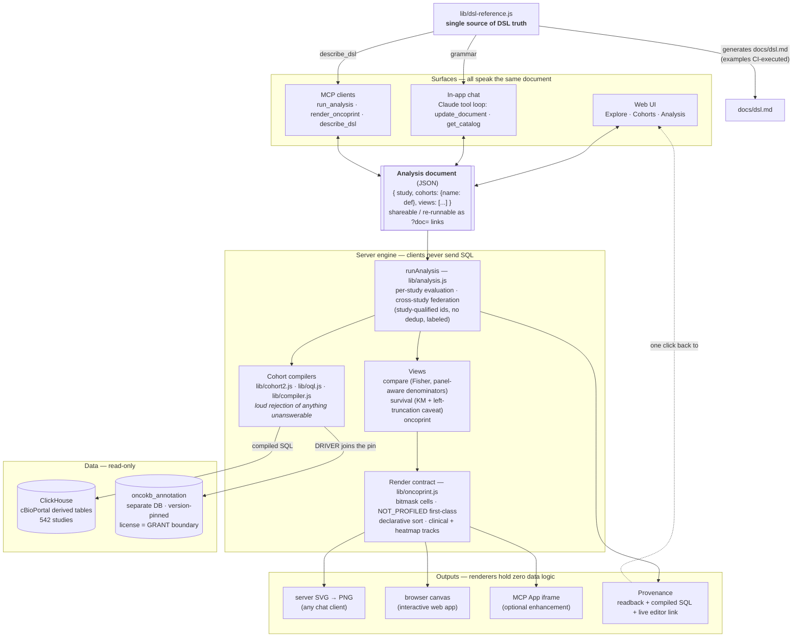

# Cohort Lab — what it is and why it's built this way

## In one sentence

Cohort Lab is a demonstration that a cBioPortal-class tool can be rebuilt around **one
declarative object** — the Analysis document (cohorts defined by OQL / clinical / timeline
clauses, plus views) — that a human, a chatbot, and an MCP client all read and write, with the
server compiling it to ClickHouse SQL and every result carrying its own provenance.

That one object also carries the project's future (roadmap sections at the end of this
document): **saved**, it generalizes the portal's user state — virtual studies, groups,
sessions — from frozen ID lists into living, diffable definitions with dynamic membership and
versioned annotation; and being a **portable representation of the question** rather than of
any backend, it extends naturally across portal instances — up to privacy-preserving
federation where only documents and results cross institutional boundaries.

## The advantages of the approach

**1. The document is the deliverable, not the picture.** A chat conversation doesn't end in a
screenshot; it ends in a small JSON object that *is* the analysis. That object re-runs
identically later (OncoKB annotations are version-pinned), can be handed to a colleague as a
URL, edited in the UI, or refined in another conversation. This is the single biggest advantage
over "chatbot draws a chart": the artifact survives the conversation. It is also the seed of a
better persistence model than the portal's — a saved definition subsumes virtual studies,
groups, and sessions, and makes dynamic groups and annotation-version diffs corollaries rather
than projects (see *User state*, below).

**2. Trust boundaries that make an LLM safe to put in front of real data.** The model never
writes SQL — it writes the DSL, the server compiles it. Anything the data can't honestly answer
is rejected loudly (`GAIN` unsupported, unknown attribute, profile doesn't exist in this study)
instead of silently approximated, so hallucination turns into a visible error the model
corrects — not a plausible wrong number. Methodology caveats are attached to results *by the
engine*, not left to the model's goodwill (concrete examples below).

**3. Provenance as the answer to "why should I believe this?"** Every result links to a page
showing the definition, the exact SQL each cohort compiled to, and the live re-runnable
analysis. For a scientific audience this is the feature: a skeptical reviewer can audit the
whole chain without trusting either the chatbot or us.

**4. One interface, many cheap surfaces — and many cheap backends.** Because everything speaks
the document, each new surface has been thin: the in-app chat is a small loop around the same
`runAnalysis`, the MCP tools are wrappers over the same engine, and the DSL documentation is
*generated from* the same source module the chat prompt uses — so nothing can drift, because
there is one semantics owner. The same property cuts the other way: since no SQL ever crosses a
study boundary, the backends can multiply as cheaply as the surfaces did — cross-instance
federation is a routing change, not a redesign (see *Cross-instance federation*, below).

**Visualization is layered accordingly**: server-rendered PNGs for any chat client
(works everywhere, today), and a provenance/editor link that opens the fully interactive
version in the web app one click away. Fancier in-chat rendering (MCP Apps) exists as an
optional, additive experiment on top — the load-bearing path never depends on it.

## The shape of the system

Every surface reads and writes the same document; the engine owns all semantics; data access is
read-only with the licensed annotation store isolated behind its own database grant; and the
DSL's documentation, chat grammar, and MCP self-description all render from one source module.

## Methodological honesty, with concrete examples

These four caveats are not fine print — each one changes real numbers materially, which is why
the engine computes and attaches them rather than leaving them to prose. All figures below are
reproducible against the live app (msk_chord_2024, 24,950 patients, OncoKB v7.4 pinned).

### Panel-aware denominators

Not every patient was sequenced for every gene. **MSH3** sits only on the newer MSK-IMPACT
panels: in MSK-CHORD, 19,979 of 24,950 patients were profiled for it. 510 patients carry an
MSH3 alteration — that's **2.6%** of the profiled, but only **2.0%** if you naively divide by
the whole study. The naive figure understates the frequency by a quarter, and the error is
invisible for genes on every panel (TP53: 53.5% either way), which is exactly what makes it
treacherous. Cohort Lab therefore renders "not profiled" as a first-class oncoprint cell state
(striped — a different statement than "no alteration") and computes every frequency and every
Fisher test over profiled patients only.

### Left truncation

Survival in MSK-CHORD is measured from each study's own baseline — effectively the MSK
sequencing date, not diagnosis. A patient must have survived long enough to be sequenced at MSK
to enter the cohort at all, so naive Kaplan–Meier curves carry immortal-time bias. When Cohort
Lab reports, say, median OS of **20.2 months for STK11-driver patients**, the attached caveat
says exactly what that number is: months from *this study's baseline*, not from diagnosis —
which means it cannot be compared against literature medians measured from diagnosis, and
cross-study survival comparisons additionally note that the two studies' baselines are not
harmonized with each other.

### Prior-treatment guard

"First-line immunotherapy" is a temporal claim the data only partially supports: roughly 20% of
MSK-CHORD's treated patients carry an NLP-derived "prior medications to MSK" flag, and another
~20% are undetermined. The difference is not marginal: **3,341** patients have a "first"
immunotherapy event on their MSK timeline, but only **2,392** remain after the prior-treatment
guard (`priorGuard: true`) — meaning **28% of the unguarded cohort** received their *observed*
first immunotherapy, not necessarily their *actual* first. Cohort Lab makes the guard an
explicit DSL flag and warns whenever a query leans on "first" without it. (The same honesty
applies to absence queries: `NOT_FOLLOWED_BY` supports an observability guard so "no
progression recorded" is not conflated with "lost to follow-up".)

### No cross-study deduplication

A cohort spanning **msk_chord_2024 + msk_met_2021** with `TP53: MUT` contains **25,555
members: 13,105 from CHORD plus 12,450 from MET**. These are two MSK studies with overlapping
enrollment windows — some of those are the same human being counted twice, and the data
provides no reliable way to link them. Rather than pretend otherwise, Cohort Lab keys every
cross-study member by `study + patient id`, never deduplicates, and says so in every federated
view: comparisons caption it, oncoprints add a Study track showing each column's origin and note
that duplicates appear as separate columns, and the Explore header reads "(overlap not
deduplicated)". The deliberate design position: an honest count with a stated limitation beats
a "corrected" count resting on a linkage the data can't support.

---

*The common thread: every one of these is enforced in the engine (`lib/analysis.js`,
`lib/oncoprint.js`, `lib/compiler.js`), surfaces in results as machine-attached captions, and
is documented in the generated DSL reference (`docs/dsl.md`) whose examples are executed
against the live compiler on every test run.*

## User state: from frozen ID lists to living definitions

*(Proposed direction — not yet built. This may be the strongest justification of all.)*

The portal's persistence artifacts — **virtual studies, groups, sessions** — are what make
analysis reproducible, continuable, and shareable across time. Underneath, they are all the
same thing: **frozen ID lists** in the session service. That representation was never a design
choice; it was forced. The portal has no language for *why* a sample belongs to a group, so
the only thing it can save is the enumeration. Every known weakness of these artifacts follows:
virtual studies go stale as studies grow, groups can't explain themselves, a session can be
reloaded but not meaningfully edited.

A DSL cohort is the **intensional** counterpart — it saves the *rule*, not the roster. Once
the saved artifact is a rule, two long-wished-for features stop being projects and become
corollaries:

- **Dynamic groups** are just *evaluation time*: "STK11-driver never-smokers" re-run today
  includes the patients loaded since the cohort was saved. The portal could never build this
  without first building a membership language — the language was the hard part, and it exists.
- **Versioned annotation** is already half-built here: a saved definition plus the OncoKB pin
  is a reproducible driver-dependent cohort — structurally impossible in the portal, where
  annotation is baked into the database at load time.

### The artifact model: definition + frozen evaluation + diff

Extensional artifacts aren't wrong — a published paper's cohort *should* be frozen. The saved
artifact should therefore be a trio: **(1)** the definition (small JSON — the rule), **(2)** a
frozen evaluation (member ids, counts, annotation pin, data timestamp at save time), and
**(3)** the diff between them, computed on demand. That covers all three portal verbs and adds
a fourth the portal has never had:

| verb | mechanism |
|---|---|
| **Reproduce** | the frozen evaluation — exact members, exact pin |
| **Continue** | re-evaluate the definition against today's data |
| **Share** | the definition is self-describing (readback, pills, compiled SQL — provenance already built) |
| **Understand change** | the diff: *"since you saved this: +214 patients entered, 3 left; 12 membership changes came from OncoKB v7.4→v7.5 reclassifying STK11 variants"* |

Drift stops being a silent bug (the stale virtual study) and becomes a first-class, explained
result. A dynamic group with drift notifications is effectively a continuously running
screening rule — for use cases like trial matching, genuinely new capability.

### Why this completes the chat-first argument

A chat transcript is not a scientific artifact — it can't be re-run, diffed, or cited. The DSL
is the **persistable residue of a conversation**: chat needs the language to be *safe*
(trust boundaries, above), and it needs the language to have *memory*. A user-aware MCP server
is the natural custodian, because one artifact store then serves every surface — "compare my
STK11 cohort against never-smokers" in chat, a "My cohorts" list in the web UI, `$ref`-style
cohort references inside analysis documents over MCP.

Architecturally this is an evolution, not an invasion: cBioPortal already keeps user state
outside the portal database (the session service). This keeps that separation — a small
writable artifact store, never the read-only analytics database — but upgrades what is stored
from ID lists to definitions. Virtual studies are subsumed rather than replaced: DSL cohorts
are already cross-study, which is the main thing virtual studies exist to do.

### Honest caveats

Full reproducibility needs **data versioning** too — a definition re-evaluated after a study
re-import changes with no pin to blame. The frozen evaluation is the pragmatic fallback (the
exact saved members are always retained), but a real deployment would stamp import
timestamps/release tags into evaluations so the diff can attribute change: *data changed* vs
*annotation changed* vs *the rule matched differently*. And **identity is real work** (OAuth on
the MCP server, auth on the web app) — unglamorous but well-trodden.

A minimal demonstrator: a tiny writable store; `save_cohort` / `list_cohorts` / `diff_cohort`
as MCP tools and UI; `$ref` resolution in documents; and one staged demo — save a cohort, bump
the OncoKB pin, show the diff explaining exactly which patients moved and why. That last
screenshot is the whole pitch in one image.

## Cross-instance federation

*(Proposed direction — not yet built. A long-standing community wish — GENIE + public portal +
institutional private instances — that this architecture is accidentally already shaped for.)*

The critical enabling fact: **no SQL in this engine ever crosses a study boundary.** The
compilers are single-study by design, and all federation — cross-study cohorts, compare,
survival, oncoprint, explore — happens in the application layer by merging study-qualified
member ids in JS. Every SQL statement the engine emits is therefore already executable against
*whichever database holds that study*. Fulfilling one analysis document from multiple
ClickHouse instances is not a redesign; it is a **routing change**:

- the connection layer grows a registry (`chQuery(sql, instance)` instead of one fixed
  connection);
- studies become instance-qualified (`genie:brca_...`), with explicit collision handling since
  the same study id can exist on two instances;
- member ids gain one more prefix (`instance:study_pid`) — and the standing no-deduplication
  policy becomes *more* correct, since overlapping patients across institutions genuinely
  cannot be linked;
- per-study caches re-key by `instance:study`.

The compilers, OQL parser, render contract, and view merge logic need zero changes — the
payoff of having refused cross-study SQL from the start.

### The honest hard parts

1. **The OncoKB store**: `DRIVER` joins `oncokb_annotation` on the same connection, so the
   store must be replicated per instance — small (≈135k variants), the sync pipeline is
   idempotent, and replicating the *same pin* everywhere strengthens reproducibility (one pin
   across the federation, or a loud label when pins diverge). License-as-GRANT scales
   naturally: each instance grants or doesn't, and the engine already degrades loudly.
2. **Partial availability**: per-instance timeouts and *labeled* partial results ("GENIE
   unreachable; counts exclude it") — the caveat machinery already used everywhere else.
3. **Schema drift**: instances on different portal versions need a schema-version handshake
   and loud rejection below the floor.
4. **Per-instance authorization**: real work, but it composes with the identity layer from the
   user-state proposal above rather than adding a second system.

### Two federation modes

The DSL enables both, and they serve different trust models:

| mode | instance is reached as | what crosses the wire | fits |
|---|---|---|---|
| **Data-level** | another ClickHouse connection | patient-level rows, merged by the one engine | instances under one trust umbrella |
| **Document-level** | another Cohort Lab engine, over MCP | sub-documents out; *results* back | institutions that cannot share patient-level data |

Document-level federation is the deeper possibility: an institution could answer compare views
with per-group aggregates and survival with computed KM curves while member ids never leave
the building — privacy-preserving federated analysis. The community has wanted cross-instance
analysis for years; the blocker was never plumbing but the absence of a **portable
representation of the question**. That representation is precisely what the analysis document
is — which makes federation the strongest stress-test of the project's central claim: one
declarative document, many backends.
