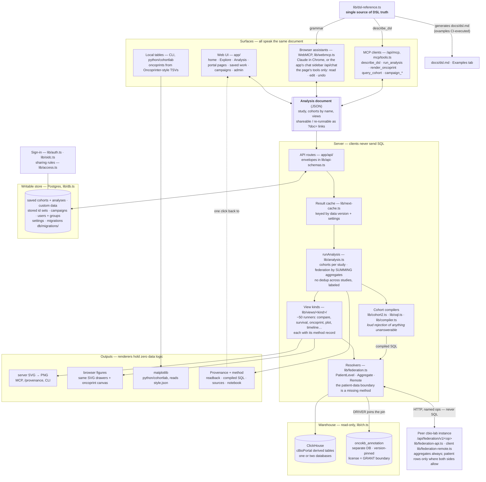
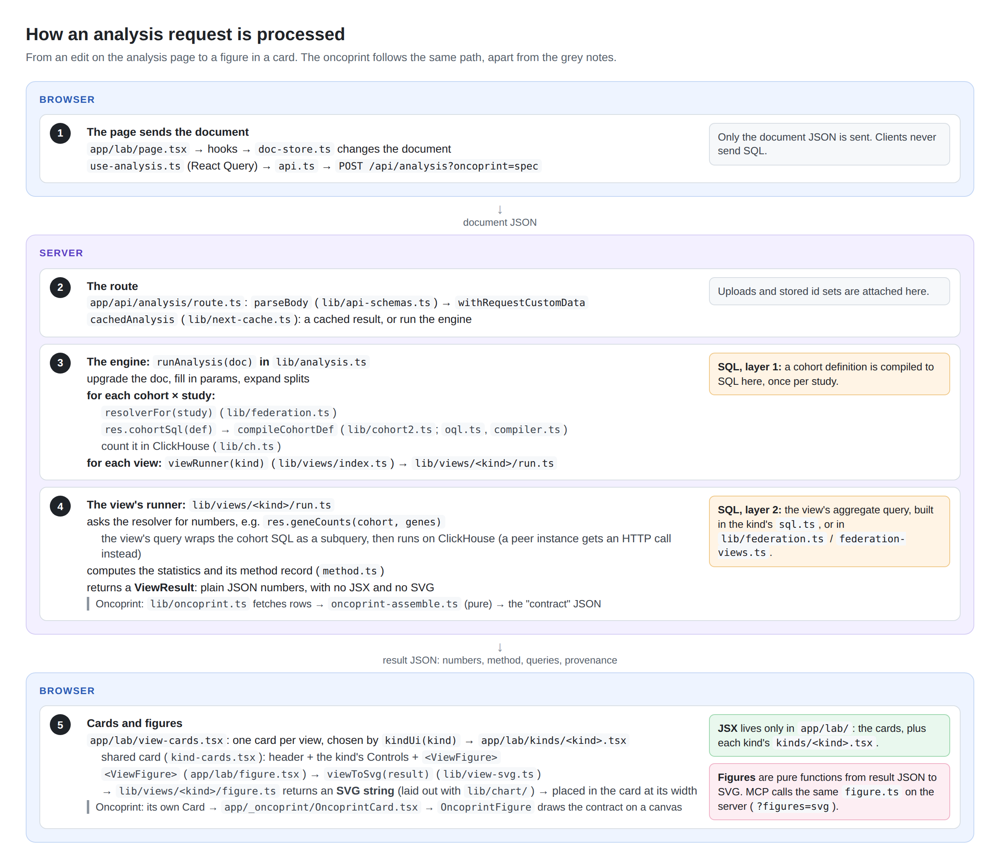
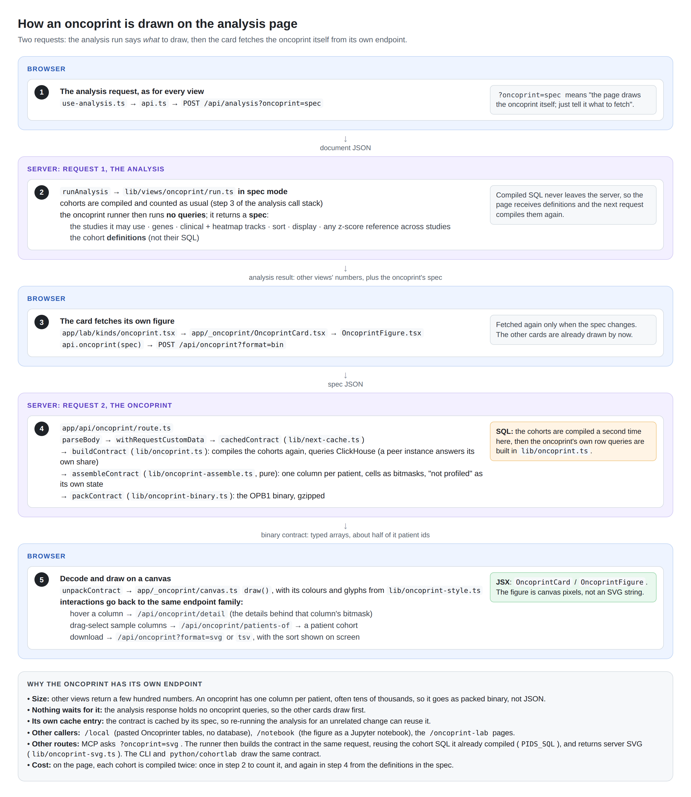

# Architecture

The map of the code: what each part does, where it lives, and the one place each rule is kept.
[`CLAUDE.md`](../CLAUDE.md) indexes it, and holds the invariants that outrank it.

## The shape of the system

Every surface reads and writes the same document; the engine owns all semantics; the warehouse is
read-only, with the licensed annotation store isolated behind its own database grant; what people
keep lives in a separate, writable Postgres; another instance is reached through the federation
API, never MCP; and the DSL's documentation, agent grammar and MCP self-description all render
from one source module.

## How a request is processed

An analysis request, from the page to the SQL and back to each view's card and figure: where
cohort SQL is compiled (`lib/cohort2.ts`), where each view's queries are built (its `sql.ts`, or
`lib/federation.ts` / `lib/federation-views.ts`), and where JSX and figures come from (`app/lab/`
for JSX; each kind's `figure.ts` for an SVG string).

The oncoprint takes a second request: the analysis run returns only its spec, and the card fetches
the contract from `/api/oncoprint` as binary and draws it on a canvas.

Both are drawn from HTML in `docs/diagrams/`: edit the HTML, run `node scripts/render-diagrams.cjs`,
and commit both.

## The parts

- **`lib/cohort2.ts`** — DSL v2 cohort compiler: `{all:[clause]}`, clause = leaf | `{any:[...]}`
  | `{not:leaf}`; leaf kinds: `oql`, `clinical`, `event` (v1 timeline sub-DSL), `patients`,
  `profiled`, `caseList`, `genomicData`, `genericAssay` (+deprecated `alteration`→OQL).
- **`lib/oql.ts`** — the honest OQL subset; `DRIVER` joins the version-pinned OncoKB store.
- **`lib/compiler.ts`** — v1 timeline/event sub-DSL (BEFORE/DURING/NOT_FOLLOWED_BY,
  observability guard, priorGuard, derived treatment lines).
- **`lib/analysis.ts`** — `runAnalysis(doc)`: evaluates cohorts (per-study; cross-study
  federation via study-qualified member ids), then hands each view to its kind's runner.
- **View kinds** — **each kind is a folder, `lib/views/<kind>/`, plus one page file,
  `app/lab/kinds/<kind>.tsx`, and a line in each of four registries.** The folder holds `types.ts`
  (the kind's spec and result fields: it adds its entry to `ViewSpecs`, `ViewResultFields` and
  `ViewResultMain` in `lib/types.ts` by `declare module`), `run.ts` (the runner), `sql.ts` (its
  queries; `test/boundary.test.ts` sweeps every kind's), `method.ts` (its method record, invariant
  12), `figure.ts` (its SVG), `kind.ts` (its descriptor: figure, title, results text, help,
  federation need, marks — `ViewKindDef` in `lib/views/kind-def.ts`) and `doc.ts` (its part of the DSL
  reference: its row of the Views table, its agent-grammar entry and its own gallery examples —
  `KindDoc` in `lib/views/kind-doc.ts`; never add a kind's text to `lib/dsl-reference.ts` itself). The page file is its
  `KindUi` (`app/lab/kinds/kind-ui.ts`): its add-view dialog entry, the category it is listed under
  (`VIEW_CATEGORIES`, the dialog's sidebar; `app/lab/add-view-dialog.tsx`) and why it is disabled, the view a new
  one starts from, how many cohorts it draws, and its card — the shared card
  (`app/lab/kind-cards.tsx`) with its subtitle, controls and body, or a `Card` of its own. The
  registries are `lib/views/index.ts` (runners), `lib/views/kinds.ts` (descriptors),
  `lib/views/docs.ts` (DSL reference) and `app/lab/kinds/index.ts` (page files); each is typed by `ViewKind`, the `View` union's kinds, so
  a kind missing from any of them does not compile, and everything else (`lib/view-svg.ts`,
  `lib/result-text.ts`, `VIEW_HELP`, `viewNeed`, the add menu, the cards) reads them. A runner gets
  the run's context (`ViewRun` in `lib/views/run.ts`: the document, evaluated cohorts, resolvers,
  the view's cohorts and studies) and returns its result; `lib/views/shared.ts` holds what several
  runners use (`overLimit`, `answering`, `refuse`, `askEachSite`). A result is a `ViewResult`, a
  union over kinds: the common fields (`ViewResultCommon`) plus its kind's own, so checking `kind`
  narrows it and reading another kind's field does not compile. A drawn result (no `error`, not
  `empty`) carries its kind's main field (a runner's success path must fill it), and `isDrawn(v)` is
  the check after which that field is read without `!`; a figure takes `DrawnResultOf<"<kind>">`. A
  refusal or error for a kind known only at run time is `plainResult(kind, {…})`. Kinds registered
  through `drawn()` have their figure drawn from the result and a throw reported as the view's
  error. **Kinds never import each other:** a kind's files import only one another and the shared
  modules (`lib/views/`: run, shared, rows, covariates, kind-def, text; `lib/figures/`;
  `app/lab/kinds/`: kind-ui, parts) — `local/kind-boundary` in `eslint.config.mjs` enforces it, and
  only the registries list every kind; what two kinds need moves into a shared module, listed there.
- **`lib/oncoprint.ts`** — spec → rows (ClickHouse fetch); **`lib/oncoprint-assemble.ts`** — rows →
  render contract, pure (bitmask cells, NOT_PROFILED=-1, panel-aware denominators, staircase +
  declarative `sort`, clinical tracks incl. numeric heat, `heatmap` molecular tracks incl. synthetic
  `VAF`). `lib/oncoprint-local.ts` builds assembler input from Oncoprinter-style TSVs;
  `lib/oncoprint-binary.ts` is the OPB1 wire format. Renderers are dumb and share
  **`lib/oncoprint-style.ts`** (THE visual decisions: palette, glyph bands, mutation priority, legend,
  `cellLayers`) and **`lib/oncoprint-lod.ts`** (level-of-detail bucketing): `lib/oncoprint-svg.ts`
  (server SVG: web app, `/provenance`, CLI), `app/_oncoprint/` (browser canvas + the shared `OncoprintFigure`),
  `python/cohortlab` (numpy/matplotlib,
  reads the generated `style.json`; `npm run style:gen`, drift fails `npm test`).
  `scripts/oncoprint-cli.ts` and `python -m cohortlab` wrap all of this for local tables, and
  `/oncoprint-lab/import` does the same in the browser (`POST /api/oncoprint/local`).
  `lib/oncoprint-cluster.ts` orders columns by a Ward dendrogram for the `cluster:<profile>`
  sort key; `lib/oncoprint-detail.ts` answers one column at a time for tooltips. **`lib/view-svg.ts`** — the same contract for every other view kind: it draws
  each kind's figure through its descriptor (`lib/views/kinds.ts`); used by the page (drawn in the browser) and by MCP `run_analysis`
  for its figures (the oncoprint's image included).
- **View aggregates** — most view kinds after the first few (`genome`, `pathways`, `enrichment`, …)
  query through the resolvers' `viewAggregate`/`viewAggregateMany`/`viewMeta`, whose SQL lives in
  **`lib/federation-views.ts`** (re-exported by `lib/federation.ts`, so the boundary suite sweeps
  it). Every local participant has those methods, a remote peer does not, so such a view is not
  drawn over a peer's studies (`lib/view-coverage.ts`, invariant 10 in CLAUDE.md).
  Figures: **`lib/views/<kind>/figure.ts`**, drawn through the kind's descriptor (`kind.ts`, listed in
  `lib/views/kinds.ts`) by **`lib/view-svg.ts`**; what several figures share is in `lib/figures/`; all
  browser-safe, laid out with **`lib/chart/`** (see "Figures share one layout kit" in docs/UI.md); cards:
  `app/lab/kinds/<kind>.tsx`.
- **Table views** (`table`, `mutations`, `timeline`'s patient list, `alterations`' list and three tables, and any later view that lists rows) — **every one must
  support the same five things: pagination, search over its text, a filter per column (text
  conditions or a value list for text, a range for numbers), sorting, and a CSV download of every
  row kept — plus choosing the columns shown.** Don't build these per view: a table supplies only a
  `RowSource` (its `rows` CTE and how each column reads off it, beside the table, e.g.
  `lib/mutation-table.ts`) and **`lib/table-query.ts`** does the rest in the database (validation,
  search, filters, sort, page, counts, a column's values for its filter). The query
  (`columns`/`search`/`filters`/`sort`, type `TableQuery`) is part of the view's spec — the page is
  not. The rows name patients, so they run only through `PatientLevelResolver.rowsPage`/
  `rowsCounts`/`rowsValues`/`rowsRank` (asserted in `test/boundary.test.ts`); `lib/views/rows.ts`'s
  `runRows` groups parts per database and pages across them. UI: **`app/_table/DataTable.tsx`**;
  `POST /api/view-page` (a page, or a column's values) and `POST /api/table` (the CSV) serve every
  table view. A view holding several tables (`alterations`) names one with `table` in those
  requests (`RunOpts.table`), and `pagedTable()` in `lib/views/rows.ts` picks it from the result.
- **The `alterations` view** (cBioPortal's patient-view genomic tables, runner `lib/views/alterations/run.ts`) — one
  patient's Mutations, Copy Number Alterations and Structural Variants as three table views in one card, each
  with its own query under its own spec key (`mutations`, `cna`, `sv`); the top-level query is the patient list's.
  Row sources in **`lib/patient-alterations.ts`** (one row per variant / call / event however many of the
  patient's samples carry it). Local patient-level participants, and a peer whose rules allow `alterations`
  (opt-in patient-level federation, below): the peer pages each table in its own database.
  Its navigator is the timeline's: **`app/lab/patient-nav.tsx`** (‹ prev / next ›, the List/Search dialog,
  ← / →) serves every view that shows one patient of a cohort at a time, stepping by the result's `position`
  (`listPosition()` in `lib/views/rows.ts`).
- **The `timeline` view** (cBioPortal's patient-view Timeline, runner `lib/views/timeline/run.ts`) — one
  patient's clinical events as tracks, with its cohort's patients (a table view) to pick from. **`lib/timeline-tracks.ts`** is
  the track model, ported from cbioportal-frontend's `cbioportal-clinical-timeline` package and
  `patientView/timeline/timeline_helpers.tsx`: the portal's track order and `trackStructures`
  nesting, lone-"Other" absorption, line charts for all-numeric lab results, numbered sample
  markers, the year axis with empty runs cut. **`lib/timeline-svg.ts`** draws it, browser-safe:
  the lab card (`app/lab/timeline-body.tsx`) and the MCP figure are the same drawing. The queries
  (`lib/patient-timeline.ts`) name a patient, so they run only through
  `PatientLevelResolver.patientTimeline`/`rowsPage`/`rowsRank`. The view reads one cohort; its
  navigator (cohort, the patient list — a `<dialog>` holding the `DataTable` — and ‹ prev / next ›) steps by the result's `position` — the drawn patient's place
  in the list's order (`rankSql`) and its neighbours — setting `patient`. The chosen `patient`, folded `collapsed`
  tracks and `expandGaps` are in the spec; the last two are drawn in the browser (`dataPart`).
  **Opt-in patient-level federation** serves this view, `alterations`, a plot's cases (`plot`;
  a plot's aggregates cross for any peer through the federation API's `plot` op) and an oncoprint's
  columns (`oncoprint`: the peer answers its study's share, `StudyInputs` in `lib/oncoprint.ts`, and
  the contract is assembled from it beside the local studies' rows), per study and kind
  of data: rules (`lib/disclosure.ts`; `study:timeline+alterations+plot+oncoprint`, `*` for every study) in the
  peer's `FEDERATION_DISCLOSE_PATIENTS` add and gate the `patient-rows`/`patient-timeline`/`plot-cases`/`oncoprint-columns`
  ops (`lib/federation-api.ts`), and the same rules in the coordinator's
  `FEDERATION_ACCEPT_PATIENT_LEVEL` decide what it accepts — data crosses
  only where both allow it. The coordinator reaches the peer through `RemotePatientResolver` /
  `RemoteTimelineResolver` (`patientRows()` names a table in `PEER_TABLES`, never SQL; aggregate-only
  for every other view); `runRows`' `remote` option pages a peer's rows beside local databases. A new
  patient view joins by adding a kind, its tables to `PEER_TABLES` and the peer's op, and
  `rowHolders(ctx, kind)`. `LOOPBACK_PEER=b` (`lib/loopback-peer.ts`) serves the second database
  to the app itself as a simulated peer — one app, both databases, federation over real HTTP calls
  to its own `/api/federation/v1`;
  the gate runs `scripts/e2e-federation.cjs` that way. See `docs/DATA-BOUNDARY.md`.
- **`lib/event-names.ts`** — **THE only place timeline event names are normalized.** Case-fold and
  trim, nothing else; measured to be complete for event types and attribute keys (zero residual
  collisions). Folds are disclosed in the caveat, never silent. Do not fork it. Every timeline
  match in SQL — event type, attribute key, attribute value — goes through its `foldedEqualsSql` /
  `foldedInSql`, which fold column and literal with the same SQL function.
- **`lib/treatment-lines.ts`** — **THE definition of a treatment line**, shared by the `sequence`
  view, the DSL's "Treatment line (derived)" (and MCP `derive_treatment_lines`) and the `lines`
  derived metric: systemic-therapy records (class = SUBTYPE, else TREATMENT_TYPE, on
  `SYSTEMIC_LINE_CLASSES`) grouped by the gap rule. Never build lines anywhere else;
  `test/treatment-lines.test.ts` asserts every caller's line-building SQL is identical.
- **`lib/params.ts`** — template parameters. A value that is EXACTLY `"$name"` is replaced by
  `doc.params.name`; no interpolation, no expressions, no chaining, keys never substituted. The
  resolved document is an ordinary one, so everything downstream stays as strictly typed as
  before (`AnalysisDoc` = resolved, `TemplateDoc` = as authored). `runAnalysis` is the boundary.
  Also `parameterize()`, the one-click lift of study + a shared gene list.
- **Splits** (`cohorts[name].splits`, and `arms[i].splits` to nest) — a cohort divided into child
  cohorts that are disjoint and add up to it, for comparison. Stored as a tree on the cohort; the
  engine and page work on a flat form keyed `"<cohort> / <split>"` (`flattenSplits` /
  `unflattenSplits` / `editSplits` in **`lib/partition-arms.ts`**, browser-safe, which also builds
  and edits arms and holds the value-ranking rule shared with `splitBy`). **`lib/cohort-partitions.ts`**
  expands each split into ordinary child cohorts (`"<cohort> / <split> / <arm>"`, each `extends` its
  parent) before `extends` resolves: arms are a first-match-wins decision chain, and an arm's condition
  must be decidable first (OQL → profiled for that gene and type, panel-aware; clinical → a value is
  recorded), else the patient goes to a named "Not profiled" / "No … recorded" child, never to
  wild-type or Other. `runAnalysis` counts every child and reports `result.splits[...].conserved`; a
  view's `cohorts` chooses what it draws (`expandSplits`): a cohort's name is the whole cohort, a
  split's name its arms, an arm's name that arm. `proposePartition`
  (`POST /api/partition`) writes arms from the data as explicit clauses, so the document alone decides
  the children. UI: `app/lab/partitions.tsx`, the cohort card's menu, Explore charts' menus.
- **Document versions** — **`lib/doc-version.ts`** is THE place an older document is brought up to
  date. Documents carry `"dsl": DOC_VERSION`; one with an older version (or none) is upgraded where it
  enters — the page on `run()`, the engine in `runAnalysis` — and `result.upgraded` / the page's note
  say what changed; one for a NEWER version is refused, because an older engine would silently ignore
  what it does not know. A change to the document's shape, or to what an unchanged document means,
  bumps DOC_VERSION and adds an upgrade step there; never re-interpret an old shape anywhere else.
- **`lib/explore.ts`** — faceted study exploration, single + federated (`buildExploreFederated`).
- **The `composition` view** (runner `lib/views/composition/run.ts`, SQL `lib/composition.ts`, figure
  `lib/views/composition/figure.ts`) — parts of a whole per case (cell types, cell states, signatures):
  a generic-assay profile's entities or 2–16 numeric clinical attributes (`custom:` included). Each
  case's vector is built in the database (`casesCte`); every participant returns only sums
  (`compositionMomentsSql`), and the per-case stacked bars come from `PatientLevelResolver.viewRows`
  alone, without ids. Each cohort is tested against the others pooled, part by part (Welch from
  moments, BH). Gallery example on the bundled SPECTRUM single-cell data (`lib/spectrum-sc-demo.ts`,
  regenerated by `scripts/gen-spectrum-sc-demo.py` from the public CELLxGENE files).
- **Cell Explorer links** (`lib/cell-explorer.ts` browser-safe, `lib/cell-explorer-server.ts`,
  `POST /api/cell-explorer`) — a cohort's patients opened as a donor filter on a study's
  cell-explorer.cbioportal.org dataset (the cohort menu), and a Cell Explorer link or donor ids
  back into a `patientList` cohort ("+ Add cohort" → From Cell Explorer). The study→dataset
  registry is `CELL_EXPLORER_DATASETS`. Both directions name patients, so both answer only from a
  patient-level instance. A link names only the donors Cell Explorer's catalog lists for the dataset.
- **Single-cell summaries for any Cell Explorer dataset** — `scripts/gen-singlecell-summary.py`:
  `propose <slug> <study>` drafts a config (patient and sample columns, the crosswalk to the study's
  ids — direct or through a sample attribute — and candidate label and score columns, dropping columns
  that never vary within a sample); `build <config>` writes per-patient and per-sample custom datasets
  (label shares, mean scores). Reviewed configs live in `scripts/singlecell/`. Paper-specific design
  (a sorting correction, site pooling, cut-offs) stays a dataset's own script, as SPECTRUM's does.
- **Where the examples run** — the gallery examples are written for the public warehouse's studies
  (and their counts are pinned to it), so an instance on another database sets `EXAMPLES_URL`
  (`lib/site.ts`, a public environment variable — below) to a deployment that holds them. The Examples tab then says so, and Run opens a "you are leaving this
  site" dialog and the example on that deployment, in a new tab; the assistant's
  `analysis_load_example` returns that link instead of loading it. Unset, examples run in place.
- **Public environment variables** (`lib/public-env.ts`) — the ONE way a setting reaches the
  browser at run time: `PUBLIC_ENV` names them (default `EXAMPLES_URL`), `app/_env/public-env.tsx`
  writes them into the page per request (`connection()`, inside the lab layout's Suspense), and a
  client reads them with `usePublicEnv()`. Not `NEXT_PUBLIC_*`, which a build bakes in for good;
  not a fetch. A secret-shaped name is refused (`test/public-env.test.ts`).
- **Requests from the pages** go through **`app/lab/api.ts`** (`api.analysis`, `api.explore`,
  `api.oncoprint`, …), never a bare `fetch`: each takes its endpoint's envelope type from
  **`lib/api-schemas.ts`** and attaches the uploads its body uses (`withCustomData`). The routes
  parse the same envelope (`parseBody`), so a change to either side is a type error in the other.
  An envelope checks only the route's own parameters (which view, which page, which uploads) and
  passes the document, definition or spec it carries to the engine — don't grow it into a second
  schema of the DSL. A new endpoint the pages call gets an envelope and an `api` function. The one
  exception is the sign-in and custom-data endpoints (`/api/auth*`, `/api/custom-data/*`): they
  belong to `app/lab/custom-data-client.ts`, which owns that state and which `api.ts` itself
  imports, so it calls them directly — through it, never from a component.
- **Custom data** — a researcher's uploaded annotations, named `custom:<dataset>/<COLUMN>` and
  usable anywhere a clinical attribute is, stored on the server only (below; the browser keeps
  nothing — `app/lab/custom-data-client.ts` attaches references). **`lib/custom-data.ts`**: for
  each request `clinicalTable(db, attrs)` / `clinicalMetaTable(db)` merge the named datasets into the clinical
  tables as ClickHouse external tables. **Every read of `clinical_data_derived` or
  `clinical_attribute_meta` goes through those two functions** — a new reader that names the
  table directly silently ignores uploads. `attrs` is what the statement reads ("all" only when it
  truly reads every attribute), so a statement about built-in attributes gets the plain table and
  ships nothing. `lib/custom-data-server.ts` is the request boundary (patient-level studies only,
  id matching, "save as feature" membership). Results that use uploads bypass the shared cache;
  a document naming an upload the request lacks is refused (`assertCustomDataPresent`).
  **Server-stored custom data** (`lib/custom-store.ts`, the only module touching its tables):
  enabled only where the deployment signs people in, each dataset its saver's. A document pins
  what it uses as `uploads: [{as, dataset, version}]` (added by the page on run); requests send
  `customRefs` and the server loads the pinned, immutable version.
- **Stored id sets** — a cohort given as a long list of ids (`sampleList`/`patientList` with
  `"set": "<id>"` instead of `"ids"`). **`lib/id-set-store.ts`** is the only module touching its
  tables (`db/migrations/0006_id_sets.sql`): owned and shared by `lib/access.ts`, members
  immutable (trigger), soft delete, every read logged. `lib/id-set-import.ts` matches a pasted list
  to the studies' cases before saving (`POST /api/id-sets`; UI: "+ Add cohort" → "From a list of
  ids"). Every engine route passes its body as `uses` to `withRequestCustomData`, which reads the
  sets it names (`lib/id-sets-server.ts`) into **`lib/id-sets.ts`**'s request context; the compiler
  then names one ClickHouse external table per set and study, and `lib/ch.ts` uploads it only to
  the patient-level connection holding that study. A set is not read without a signed-in request
  (MCP, scripts), and an answer that reads one bypasses the result cache (`hasIdSets()`). Inline
  lists are refused by name past `INLINE_ID_SQL_LIMIT` (`lib/cohort2.ts`). In the web app every
  list becomes a set where the reader is signed in (`app/lab/id-sets-client.ts`): oncoprint
  selections and Cell Explorer imports as they enter the document, and any list still inline when a
  cohort or analysis is saved (the page's `persist`/`persistSpaces` wrappers, which give the open
  document the same sets so a re-save stores nothing new). Inline lists stay valid DSL for MCP,
  scripts and signed-out readers.
- **Signing in** (`lib/auth.ts`, the header's Sign in) guards custom data, saved
  cohorts/analyses (`/api/artifacts`) and campaign changes; exploring, analyses, `?doc=` links and
  MCP need none. A deployment has ONE way in: an OpenID Connect provider (`lib/oidc.ts`;
  `AUTH_OIDC_ISSUER`/`_CLIENT_ID`/`_CLIENT_SECRET`, optional `AUTH_OIDC_LABEL`, `AUTH_URL` behind a
  proxy — Google on Vercel, MSK's Keycloak realm `msk` on the private cluster), and/or the
  development sign-in (`AUTH_DEV_LOGIN=1`: any email, no password; refused on Vercel production;
  what `scripts/gate.sh` and session dev servers use). A session is an httpOnly cookie signed with
  `AUTH_SESSION_SECRET` naming the user; stores decide by that user's id. **People** are
  `lib/users.ts` (`db/migrations/0004_users.sql`): a sign-in is found by provider + subject, and
  joins an existing user (e.g. one added by email) only through a provider-VERIFIED email. Rows
  from before accounts have no owner and are seen by nobody until `npm run db:claim-legacy --
  <email>` gives them to someone. The OIDC flow is tested end to end against a stand-in provider
  (`test/oidc.test.ts`).
- **Sharing** (`lib/access.ts` — THE place the rules live; `db/migrations/0005_sharing.sql`): a saved
  cohort, analysis or custom dataset has an owner and a sharing — `visibility` private | group |
  public (everyone signed in to the deployment), ONE `group_id`, and `group_can_edit`. The owner
  alone deletes or reshares, and only with a group they belong to; a stale edit is refused (409,
  `saved_artifacts.version`). Lists filter in SQL (`readableWhere`), single items in code
  (`canRead`/`canWrite`/`canShare`); both stores call it, never a rule of their own. Sharing an
  analysis wider than a custom dataset it pins returns `warnings` naming the dataset — patient-level
  data is never shared but by its own owner, explicitly. **Groups** (`lib/groups.ts`) are run by
  their admins (always at least one); people are added by email, signed in yet or not, found by
  name or email prefix among those who have signed in (`searchUsers`, `GET /api/users?q=`); deleting
  a group makes what it shared private. The access matrix is in `test/support/store-contracts.ts`
  (`sharingContract`), and `npm run check:access-mutants` (a gate stage) plants six sharing bugs
  into a copy of `lib/access.ts` and requires each to fail it. A change to the rules updates both.
  On the page, the reader's OWN items stay keyed by name (`use-saved.ts`); others' come separately,
  keyed by id, since two people may use one name. UI: `app/lab/share-dialog.tsx` (owner only; from
  the saved-work manager's badges), its "Shared with you" sections and its Groups tab (below).
  Opening someone else's analysis
  gives a working copy that remembers its source (`use-workspace.ts` `sharedOpen`); where the group
  may edit, the workspace dialog's "Save to theirs" saves back from the version opened.
- **The writable store** (`lib/db.ts`, the only Postgres client): saved cohorts and analyses,
  campaigns and custom data. `DATABASE_URL` (or its older name `SUPABASE_DB_URL`) names the
  Postgres; without one, outside Vercel production, `lib/db.ts` runs an in-process Postgres
  (PGlite) itself — in `.data/pglite` under `next dev`, in memory otherwise (so every gate run
  starts empty) — so there is one SQL path and no second, hand-written store to keep in step.
  **Migrations** are `db/migrations/*.sql`, applied in name order by **`lib/migrate.ts`**, which
  records each in `schema_migrations`; every migration must stay re-runnable (`if not exists`,
  `drop trigger if exists`). A configured database is migrated only by `npm run db:migrate`
  (`npm run db:status` lists applied and pending), never by the app — run it before deploying
  code that needs a new migration. The in-process database migrates itself on first use.
  **Two roles:** the app connects as `cohort_lab_app` (`0009_app_role.sql`), granted per table only
  what the app does — no truncate, no DDL, no delete of a stored version, insert-only access logs —
  and migrations run as the tables' owner (`MIGRATION_DATABASE_URL`). A new table needs its grant in
  its migration (`test:db` refuses one without). The tests' stores run as that role too, so a
  statement it was not granted fails there. The same migration takes every table away from
  Supabase's REST API roles (`anon`, `authenticated`), which Supabase grants by default.
- **The saved-work manager** (`app/_saved/`): everything the reader keeps — Cohorts, Analyses,
  Custom data, Groups, Gene lists — one tab each, as a dialog any page opens on the tab the moment
  calls for (`useSaved().open("groups")`, or `?saved=groups` in any page's link) and as the page
  `/saved?tab=…` (`/groups` and the lab's old `?tab=cohorts` land on it). It is the only place saved
  things are listed and managed. Opening something from it acts on the page it was opened over when
  that page registers how (`useSavedActions`: the lab opens an analysis in place); anywhere else it
  is a link into the lab (`?doc=`, or `?shared=<id>` for someone else's analysis). A saved cohort's
  Actions menu (`cohort-menu.tsx`) renames it, adds a note, splits it (stored on the cohort, so every
  analysis it joins has the split), duplicates and deletes it, and edits its filters in Explore
  opened over the page (`?editCohort=<id>` from elsewhere), which saves back over it keeping its
  name, note and splits. The query cache and the manager's provider wrap every page (`app/layout.tsx`).
- **`app/lab/page.tsx`** — the app: Explore (study checkboxes + facets) / Analysis / Examples (from
  the site header). Tabs move out into their own components as they are untangled
  (`examples-tab.tsx`), and each view's card (`view-cards.tsx`: its kind's
  own or the shared one, from `app/lab/kinds/`) reads the page through one `ViewCtx`; Explore's sections (study picker, bar,
  add-chart dialog, facet cards) are `explore-sections.tsx`, reading Explore's state and actions
  from `use-explore-state.ts` (the draft, the selection, add-cohort mode) through `ExploreCtx`; the
  Analysis tab's cohort column, view column, document and genes dialogs are `analysis-sections.tsx`,
  through one `AnalysisCtx`. The page itself holds only its own state and wires the rest: its
  actions are hooks, called in dependency order — `use-tool-actions.ts` (what the AI tools do to
  the document), `use-library.ts` (the Examples tab), `use-workspace.ts`,
  `use-cohort-edits.ts`, `use-explore-state.ts`, `use-view-options.ts` (what building a view
  offers), `use-view-edits.ts`; the AI tools' bridge is `useLabTools` in `agent-tools.ts`. A new
  action goes in the hook for its kind, not in the page. State that must outlive a tab switch
  lives in those hooks, not in the tabs, since a tab unmounts when left. Server state goes through React Query, as analyses do
  (`use-analysis.ts`): saved cohorts and analyses are `use-saved.ts`, Explore's facets
  `use-explore.ts` (keyed by everything that decides the answer, so a superseded request is
  cancelled and can never land; `e2e-lab-races.cjs` holds requests to prove it). The standalone query-builder (`/`) and interactive oncoprint (`/oncoprint`)
  demo pages were retired once the Analysis app subsumed them.
- **Links (`lib/url-json.ts`)** — a document in a URL (`?doc=`, and every JSON parameter) is written
  `1.<base64url>`: the JSON raw-deflated, about half the plain form's length on the gallery and less on
  large documents, readable by any zlib. The plain base64url JSON of
  older links, scripts and hand-made links still opens. The portal pages (`app/portal/`) carry only how their
  views differ from the page's defaults (`?changes=`, `page-changes.ts`), tied to the kinds of the
  page's views in order, so changes made on another layout are refused and said so rather than
  applied to the wrong view; the defaults themselves are rebuilt from the query.
- **The homepage (`/`, `app/_home/`)** — cBioPortal's: choose studies, then **Explore selected
  studies** (the lab's Explore, `/lab?tab=explore&study=a,b`) or **Query by gene** (the gene query
  dialog, whose Submit opens the Results page). One study chooser serves it, Explore's picker and
  the Results page's "Modify query" (`app/_studies/study-chooser.tsx`: cancer types, search, the
  data Filters, quick select, select all, rows with their quick-jump icons in `study-actions.tsx`),
  and one gene editor serves every gene entry (`app/_genes/GeneQueryDialog.tsx`: `GeneQueryEditor`,
  in the dialog or in place).
- **WebMCP (`lib/webmcp.ts`)** — every page's tools for the researcher's assistant in the
  browser (Claude in the Chrome sidebar): registered with `document.modelContext` and published
  as `window.cohortLab`. The analysis page's (`app/lab/agent-tools.ts`) read and edit the
  document; edits are run by the engine and reach the page only if accepted.
- **The chat sidebar is the app's only model call, and it is just another WebMCP client**
  (`app/_agent/ChatSidebar.tsx` in the root layout; `/api/chat`; the provider in
  `lib/chat-model.ts`: `CHAT_PROVIDER=anthropic|bedrock`, `CHAT_MODEL`, `CHAT_EFFORT`). **Where it
  runs:** a dev server (`next dev`) with `CHAT_PROVIDER` set; a built deployment only with
  `CHAT_ON_DEPLOYMENT=1`, never on Vercel (no public URL spends the key), and there only for a
  signed-in user — a deployment that signs nobody in has none (providers and credentials:
  [`ENVIRONMENT.md`](ENVIRONMENT.md)). It must work the app exactly as an outside
  assistant (Claude in Chrome, Claude Desktop) does: each request sends the tools the page exposes
  (`window.cohortLab.tools`), the route declares them **without implementations**, and every call
  runs in the browser through `window.cohortLab.call`. **Never give it a private way in** — no
  tools in the route, no reading page state or calling the engine or an API directly. A capability
  it lacks is a new WebMCP tool, which every assistant then gets. Opening a page reloads it, so the conversation lives in
  `sessionStorage` and resumes on the new page's tools. No other route calls a model.
- **`mcp/tools.ts`** — MCP registry, for agents: `describe_dsl`, `run_analysis`, `render_oncoprint` (+v1
  event tools). MCP returns oncoprints as a static image rendered from the server SVG; the
  interactive figure is the web app's, not a third renderer. It serves no federation: that is
  **`lib/federation-api.ts`**, the ops one cbio-lab instance answers another at
  `/api/federation/v1/<op>` (`app/api/federation/v1/[op]/route.ts`), with
  `lib/federation-remote.ts` as its client.
- **`lib/dsl-reference.ts`** — **THE single source of truth for DSL documentation.**
- **Hypothesis campaigns** (`/campaign`, MCP `campaign_*`) — this tool as the referee for an AI
  hypothesis generator. **`lib/hypothesis.ts`** (pure, browser-safe): a hypothesis is a document
  plus ONE declared primary result and a direction; `withSplit` restricts it to one half;
  `extractPrimary` reads the deciding number; campaign-wide BH and the replication rule.
  **`lib/campaign.ts`**: the Postgres ledger (`db/migrations/0002_campaigns.sql`) and the procedure
  (feasibility from cohort sizes only → lock → discovery half → one correction → survivors on the
  validation half). **The campaign engine never calls a model**: hypotheses are written by the
  researcher's AI assistant through the campaign page's tools — WebMCP plus `window.cohortLab`
  (`app/campaign/agent-tools.ts`), whether that assistant is Claude in Chrome or the app's own
  chat sidebar, which drives the same tools — or by any MCP client. Do not add a model call to
  the campaign code. The held-out half is the
  engine's `split` leaf (`lib/cohort2.ts`): a salted hash of the patient id inside ClickHouse,
  salt pinned by `test/cohort.test.ts` — changing it reshuffles every reported result.
  **A locked campaign is immutable at the database level** (triggers); never work around them in
  application code.
- **The result cache** (`lib/next-cache.ts`; Next 16 Cache Components, `'use cache: remote'`) —
  CLAUDE.md invariant 11. On Vercel it is Runtime Cache, shared by every function instance;
  elsewhere it is process memory. Analyses, oncoprint contracts, Explore, the study catalog and the
  study list all go through it, from the web routes, `/api/mcp` and chat alike.
  - **A deploy clears it** (Next keys every entry by deployment), a data import or OncoKB release
    does too (`dataVersion()` is an argument of every cached function), and entries regenerate
    after a day.
  - **Only a returned value is stored.** A refusal, a partial answer (an instance that did not
    reply) or an abandoned query must THROW, or it is served to everyone for a day.
  - **Read through `throughCache(cached, direct)`.** A production build replaces the message of
    anything thrown inside a cached function, so when the cached call throws the direct one runs
    and reports the real error. It also covers a cache that cannot be read.
  - **An administrator clears it, and changes federation settings, at `/admin`** (the users in
    `ADMIN_EMAILS`; account menu → Admin). `lib/settings.ts`: an `app_setting` row overrides the
    environment variable of the same name for every process within seconds; federation code reads
    those settings through `setting(name)`, never `process.env`. `cacheVersion()` (data version plus
    the settings' fingerprint, which includes the last clear) is every cached entry's key argument —
    cohort locks keep `dataVersion()` alone. Database addresses and credentials are never editable.
  - **`RESULT_CACHE=off` turns it off.** `throughCache` then runs the direct call on every request,
    so a server answers everything cold — for measuring what a first reader waits for. Without a
    cache handler configured (anywhere but Vercel), the cache is the Node process's own LRU
    (`cacheMaxMemorySize`, 50 MB unless `RESULT_CACHE_MB` says otherwise): lost on restart, and not
    shared between replicas.
  - **Arguments are the key.** A cached function takes only serializable arguments and computes
    everything else itself; a function passed in cannot be called. Anything that changes the
    answer must be an argument.
  - Entries are gzipped JSON as base64 text (`pack`): Runtime Cache refuses items over 2 MB, and
    has handed typed arrays back corrupted.
  - `next/cache` exists only under Next, so the stdio MCP server, CLI and tests run the engine
    uncached; `registerTools` takes the engine to use.
- **Method records** (`lib/method.ts`) — CLAUDE.md invariant 12. A view's result carries each step
  from its queries' rows to its numbers, built from the values that computation used, plus a Python
  script that recomputes the numbers with standard libraries; `check:methods` re-runs them
  ([`docs/TESTING.md`](TESTING.md)). Numbers and settings in a record's text come from variables or
  named constants, never typed in. **A record's script is also a notebook**: the panel's "download
  as notebook" posts the document to `POST /api/analysis/notebook`, which re-runs it, rebuilds the
  files the script reads from the view's own recorded queries (`lib/method-data.ts` — the same code
  `check:methods` runs, so the export is what was checked; no SQL is ever accepted from a caller)
  and assembles the `.ipynb` (`lib/method-notebook.ts`). A view with rows from a federated peer is
  refused (403) and the notebook is capped at `NOTEBOOK_MAX_BYTES` (413). A new view kind whose
  script reads a file needs its rebuild in `methodFiles`, or the notebook says the file is missing.
- **Every build knows its commit.** `next.config.mjs` stamps it as `GIT_COMMIT`: Vercel's
  `VERCEL_GIT_COMMIT_SHA`, else a `GIT_COMMIT` passed in (the Docker image takes it as a build
  argument — `.git` is not in its context — and CI passes `github.sha`), else `git rev-parse HEAD`
  with `+dirty` for a changed tree; `next dev` says `dev`. `lib/build-info.ts` reads it; every page's
  footer shows it, linked to the commit, and `GET /api/version` returns it. A build that could find
  no commit (a hand-run `docker build` without `--build-arg GIT_COMMIT=…`) reads "unknown", never
  blank.
- **Cohorts on the analysis page** — the page shows the document's cohort store as a summary
  ("Cohorts in this analysis": size, studies, which views draw each). Since DSL 2.5 a view without
  a `cohorts` list is empty and the page shows it waiting for one; cohorts come in through a view's
  "+ Add cohort" (`app/lab/add-cohort-dialog.tsx`: the analysis's own, the library, or Explore in
  add mode, which returns the selection to that view).
- **Provenance** (`lib/provenance.ts`) — every result lists its `sources`: each database and
  federation peer, with what a peer reports about itself in every answer (name, build, each study's
  import date), and each view's participation points into that list. The document panel shows each
  cohort's compiled SQL, and every view shows the aggregate queries that produced its numbers
  (resolvers log what they run; a peer returns its own log, marked as having executed there).
